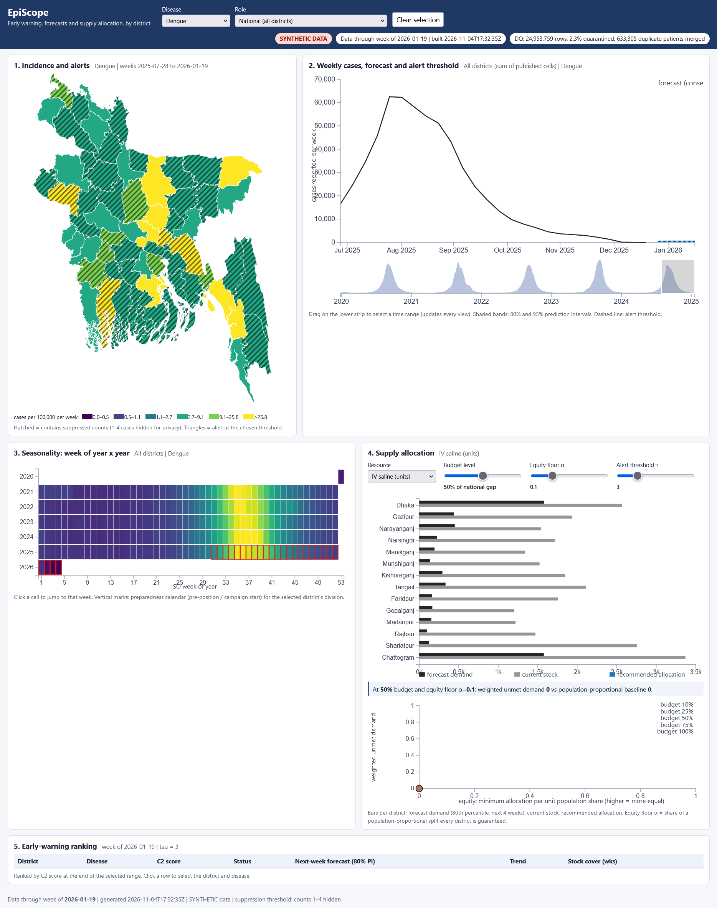
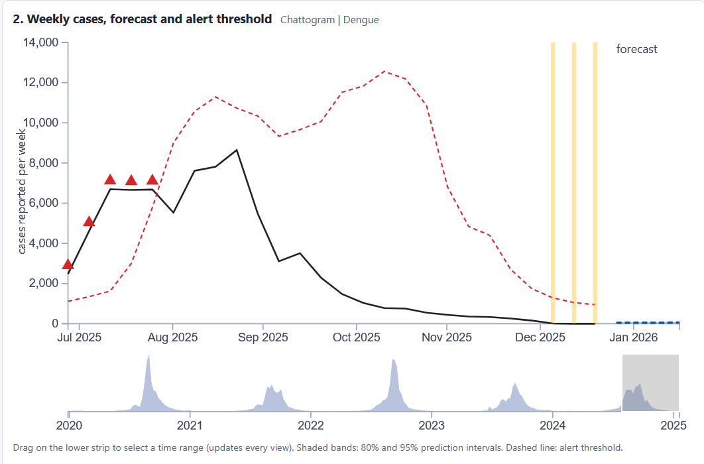

# EpiScope: Big-Data Surveillance, Forecasting and Response Planning

**Course:** CSE 4345 -- Big Data Analytics\

**Department:** Computer Science & Engineering, Premier University,

Chittagong\

**Project type:** Complex Engineering Problem (CEP)\

**Academic session:** Spring 2026\

**Repository:** https://github.com/Arnab1n1/EpiScope\

**Final release:** `v1.0` (create and push this tag before final

handover)\

**Video presentation:** `ADD THE FINAL SHAREABLE VIDEO LINK HERE`

------------------------------------------------------------------------

## 1. Project Overview

EpiScope is an end-to-end big-data surveillance and response-planning

prototype designed around the public-health scenario described in the

CSE 4345 CEP assignment. The system brings together health encounter

records, facility information, population references, weather inputs and

stock information to support district-level disease surveillance and

planning in Bangladesh.

The platform is designed to support four main decisions:

1.  Identify unusual increases in Dengue, Diarrhoeal disease,

    Influenza-like illness (ILI) and Malaria.

2.  Forecast disease cases for the next one to four weeks.

3.  Estimate hospital and medical-supply demand and recommend allocation

    under a limited budget.

4.  Prepare a seasonal calendar to help plan supplies and prevention

    activities.

The project connects data generation and ingestion, data cleaning,

quality checks, privacy controls, epidemiological analytics, resource

optimisation and a D3.js dashboard in one workflow.

> **Data notice:** Patient encounters, facility activity and stock

> records generated by this project are synthetic. Public population

> reference data is attributed to the Bangladesh Bureau of Statistics

> (BBS). Weather is treated as observed data only when the Open-Meteo

> fetch process has successfully populated the weather cache. If that

> cache is unavailable, the generator uses synthetic weather. Forecasts

> and results produced from synthetic encounters are experimental

> outputs, not real-world disease estimates or official public-health

> advice.

## 2. Main Capabilities

### 2.1 Data generation and ingestion

-   Deterministic generation of synthetic health encounters using a

    configurable scale factor and random seed.

-   Generation of facility registry and stock/bed snapshot data.

-   Support for historical data generation and a separate

    incremental-drop generation mode.

-   Bronze ingestion that retains source data and adds ingestion

    metadata such as source, load time, batch identifier and file

    checksum.

-   Parquet-based storage for the processed data layers.

### 2.2 Bronze, Silver and Gold data pipeline

The processing pipeline is divided into three layers:

-   **Bronze:** stores ingested source records with ingestion metadata.

-   **Silver:** applies type conversion, validation, de-identification,

    duplicate handling and quarantine processing.

-   **Gold:** creates aggregated epidemiological and operational

    datasets for detection, forecasting, allocation and dashboard use.

The pipeline also includes batch tracking and logic for processing newly

received batches. Gold outputs are rebuilt from the processed Silver

data so that late-arriving records can be reflected in the analytical

datasets.

### 2.3 Data quality and provenance

The project includes automated quality checks for issues such as:

-   Required fields and schema validity.

-   Missing or invalid values.

-   Age and date constraints.

-   Referential integrity with facility/reference data.

-   Duplicate encounter records.

-   Valid disease and geographic information.

-   Records where onset date occurs after report date.

Invalid records are separated into quarantine outputs with reasons.

Data-quality summaries are generated for pipeline loads, and lineage

metadata is retained for processed data.

### 2.4 Privacy protection

The pipeline applies privacy controls before records are used in

analytical layers:

-   Patient identifiers are transformed using a salted hash.

-   Age is reduced to age bands for downstream processing.

-   Direct patient identifiers and exact age are not intended to be

    exposed in Silver and dashboard outputs.

-   Small patient-count cells from 1 to 4 are suppressed in published

    outputs.

-   Dashboard data is exported as aggregated JSON rather than

    encounter-level records.

-   National and district dashboard data are separated into different

    bundles.

The repository must not contain the private hashing salt, API keys or

other secrets. Use `.env.example` as the configuration template.

### 2.5 Outbreak detection

The analytics layer contains outbreak-detection implementations based

on:

-   EARS C2.

-   CUSUM.

Detection results are evaluated against the generated outbreak ground

truth. The evaluation includes sensitivity, false-alert measures and

detection delay. The project also compares a naive detection path with a

gated path that considers reporting artefacts and incomplete reporting.

### 2.6 Disease forecasting

The forecasting module produces one-to-four-week-ahead district-level

forecasts for disease counts. The model uses historical case patterns

and lagged weather features where available.

The evaluation module performs rolling-origin backtesting and compares

model performance with a seasonal-naive baseline. Reported metrics

include:

-   Mean Absolute Error (MAE).

-   80% prediction-interval coverage.

The current experiment includes Dengue and Diarrhoeal disease

backtesting. Production forecast outputs are also generated for Dengue,

Diarrhoeal disease, ILI and Malaria.

### 2.7 Demand estimation and resource allocation

Forecasted cases are converted into estimated operational demand,

including hospital beds and medical supplies. The optimisation module

uses a linear-programming approach to allocate limited resources across

districts.

The project also includes:

-   A population-proportional baseline for comparison.

-   Multiple budget and equity-floor scenarios.

-   Precomputed allocation scenarios for dashboard what-if controls.

-   A seasonal preparedness calendar based on disease seasonality.

These outputs are decision-support estimates based on stated

assumptions, not actual procurement or deployment instructions.

### 2.8 Interactive dashboard

The dashboard is implemented with D3.js v7 and locally served from the

repository. It provides national and district-level views of the

generated analytical outputs.

The dashboard includes:

1.  Bangladesh district surveillance map.

2.  Disease time-series and forecast analysis.

3.  Seasonal pattern/heatmap view.

4.  Resource allocation and what-if controls.

5.  Early-warning ranking table.

Users can explore disease and district information, review forecast

patterns and inspect resource-allocation scenarios. The dashboard uses

aggregated JSON outputs generated by the serving layer.

## 3. System Architecture

The following architecture shows how EpiScope moves data from source
generation and ingestion through processing, analytics and dashboard
delivery.

### Technology stack

  -----------------------------------------------------------------------

  Component                           Technology

  ----------------------------------- -----------------------------------

  Programming language                Python 3.11

  Distributed processing              Apache Spark / PySpark 3.5.1

  Storage format                      Parquet

  Data processing                     PySpark, Pandas for small/reference

                                      or final aggregated data

  Forecasting/statistics              NumPy, SciPy, Statsmodels

  Optimisation                        PuLP

  Dashboard                           D3.js v7, HTML, CSS, JavaScript

  Geographic data support             TopoJSON

  Testing                             Pytest

  Local serving                       Python HTTP server

  Optional orchestration/storage      Airflow DAG and MinIO-compatible

  support                             Docker configuration

  -----------------------------------------------------------------------

## 4. Repository Structure

``` text

EpiScope/

├── generator/

│   ├── generate.py

│   ├── fetch_boundaries.py

│   └── fetch_weather.py

├── pipeline/

│   ├── bronze/

│   │   └── ingest.py

│   ├── silver/

│   │   └── build.py

│   ├── gold/

│   │   └── build.py

│   ├── quality/

│   │   └── rules.py

│   ├── common.py

│   └── run.py

├── analytics/

│   ├── detection/

│   │   ├── detect.py

│   │   └── evaluate.py

│   ├── forecast/

│   │   ├── forecast.py

│   │   └── backtest.py

│   ├── optimise/

│   │   └── allocate.py

│   ├── calendar/

│   │   └── calendar.py

│   └── run_all.py

├── serving/

│   ├── export.py

│   └── suppress.py

├── dashboard/

│   ├── index.html

│   ├── css/

│   ├── js/

│   ├── vendor/

│   └── data/

├── tests/

├── orchestration/

│   └── episcope_dag.py

├── scripts/

│   ├── run_windows.ps1

│   ├── scale_experiment.py

│   └── spark_opt_experiment.py

├── docs/

│   ├── ARCHITECTURE.md

│   ├── DATA_SOURCES.md

│   ├── PROJECT_REVIEW.md

│   ├── RESULTS_SANDBOX.md

│   ├── proposal.md

│   ├── experiments/

│   ├── screenshots/

│   └── EpiScope_CEP_Report.pdf

├── requirements.txt

├── docker-compose.yml

├── Makefile

├── .env.example

├── AI_USAGE.md

└── README.md

```

Generated data folders such as `data/raw/`, `data/lake/` and local

secrets are created during execution and are not required to be

committed to the repository.

## 5. Requirements and Environment

The tested development environment used:

-   Windows 11.

-   Python 3.11.9.

-   Java JDK 17.0.12.

-   PySpark 3.5.x.

-   16 GB RAM.

-   Git.

The repository pins its Python dependencies in `requirements.txt`. Java

17 is required for the Spark 3.5.x environment.

### Install and prepare the environment (Windows PowerShell)

``` powershell

py -3.11 -m venv .venv

.\.venv\Scripts\Activate.ps1

python -m pip install --upgrade pip

python -m pip install -r requirements.txt

Copy-Item .env.example .env

```

If `.env` already exists, do not overwrite it. Keep private values and

salts outside Git.

## 6. Run the Project

### 6.1 Complete workflow using the Windows helper

For a development-scale run:

``` powershell

.\scripts\run_windows.ps1 -Task all -SF 0.05 -Seed 42

```

For the full-scale run:

``` powershell

.\scripts\run_windows.ps1 -Task all -SF 1.0 -Seed 42

```

The `all` task installs the pinned dependencies, generates data, runs

the Bronze-Silver-Gold pipeline and executes the analytics workflow.

### 6.2 Run the workflow step by step

``` powershell

# Generate synthetic source data

python -m generator.generate --sf 1 --seed 42 --out data/raw

# Run Bronze, Silver and Gold

python -u -m pipeline.run --raw data/raw --stages bronze,silver,gold

# Run detection, forecasting, optimisation and calendar analytics

python -u -m analytics.run_all

```

### 6.3 Start the dashboard

``` powershell

.\scripts\run_windows.ps1 -Task serve

```

Then open:

`http://localhost:8000`

Alternatively:

``` powershell

cd dashboard

python -m http.server 8000

```

### 6.4 Run automated tests

``` powershell

python -m pytest -q -m "not integration"

```

### 6.5 Run scalability and Spark optimisation experiments

``` powershell

# Scalability experiments at SF 0.25, 0.5 and 1.0

python scripts/scale_experiment.py --sfs 0.25 0.5 1.0 --seed 42

# Spark optimisation comparison

python scripts/spark_opt_experiment.py

```

The experiment scripts are provided for reproducible measurement. Record

the hardware, scale factor, stage runtimes, output sizes and Spark UI

evidence when running them.

## 7. Incremental / Hidden Test Drop

The repository provides a drop workflow through the Windows helper:

``` powershell

.\scripts\run_windows.ps1 -Task drop

```

The Makefile-based equivalent is:

``` bash

make drop DIR=/path/to/14-day-drop

```

The workflow processes the supplied drop through the pipeline and

regenerates analytics/dashboard outputs. For the instructor's

hidden-drop check:

1.  Place the provided 14-day drop in the specified input directory.

2.  Run the drop command without changing the pipeline code.

3.  Record the resulting batch, row, quarantine and output counts.

4.  Run the same drop again.

5.  Compare the outputs and confirm that reprocessing does not create

    duplicate records.

6.  Check that late records update the affected epidemiological weeks.

**Verification note:** The project contains idempotency-related

processing logic and tests. A successful instructor-style hidden-drop

rerun, with before/after evidence, must be recorded separately before

claiming the full hidden-drop requirement has been demonstrated.

## 8. Experimental Results

The following results are from the recorded full-scale execution and

analytics run in the project work environment. They describe synthetic

project data and should not be interpreted as real disease surveillance

statistics.

### 8.1 Data generation and processing

  Measurement                                              Recorded result

  -------------------------------------- ---------------------------------

  Scale factor                                                         1.0

  Random seed                                                           42

  Generated encounter rows                                      25,452,837

  Silver rows reported by the pipeline                          24,953,759

  Quarantined rows                                                 569,314

  Resubmissions removed                                            499,078

  Gold onset rows                                                   83,840

  Pipeline Silver + Gold runtime           2,850.6 seconds (47.51 minutes)

The recorded pipeline runtime was approximately 47.51 minutes.

Therefore, the assignment's SF=1 runtime target of 45 minutes or less

was **not achieved** in this run.

### 8.2 Analytics execution

The analytics workflow completed with the following recorded stage

timings:

  Analytics stage                      Runtime

  ------------------------ -------------------

  Detection                       30.3 seconds

  Forecast backtesting            87.6 seconds

  Production forecasting          19.7 seconds

  Optimisation                    10.2 seconds

  **Total**                  **147.8 seconds**

The selected C2 operating point in the recorded detection run used a

threshold of 8.0, with sensitivity 0.75, false alerts per day 7.27 and

median detection delay 15 days. The artefact-window comparison recorded

2 alerts for the naive detector and 0 for the gated detector.

### 8.3 Forecast backtesting

The recorded MAE comparison was:

  Disease                Horizon   Model MAE   Seasonal-naive MAE

  -------------------- --------- ----------- --------------------

  Dengue                  1 week     39.0211              93.4467

  Dengue                 2 weeks     54.5017              93.4467

  Dengue                 3 weeks     58.2504              93.4467

  Dengue                 4 weeks     59.0791              93.4467

  Diarrhoeal disease      1 week     39.0633              91.2957

  Diarrhoeal disease     2 weeks     53.3723              91.2957

  Diarrhoeal disease     3 weeks     51.5538              91.2957

  Diarrhoeal disease     4 weeks     69.7577              91.2957

The recorded 80% prediction-interval coverage varied approximately from

0.7589 to 0.8633 across the evaluated results. Coverage is therefore not

identical at every horizon and should be interpreted alongside the MAE.

### 8.4 Automated tests

The recorded test run completed with:

``` text

16 passed, 18 warnings in 950.24s

```

The warnings were Pandas deprecation warnings. The test result applies

to the test suite and code state used for that run.

### 8.5 Dashboard export

The serving workflow recorded a dashboard JSON export size of

approximately 7.21 MB, below the assignment's 10 MB target for

aggregated browser data.

## 9. Dashboard Screenshots

The following screenshots are stored in `docs/screenshots/`. Their

filenames are kept consistent with the repository.

### Dashboard overview



### Forecast analysis



### District surveillance map


### Resource allocation and seasonal analysis


## 10. Data Sources and Assumptions

  -----------------------------------------------------------------------

  Source                              Use in EpiScope

  ----------------------------------- -----------------------------------

  BBS Population and Housing Census   District population denominators

  2022                                and population reference values

  geoBoundaries Bangladesh ADM2       District boundary data when fetched

                                      and installed

  Open-Meteo Historical Weather API   Historical weather inputs when

                                      fetched and cached

  Synthetic generator (S4--S6)        Encounter, facility and stock/bed

                                      snapshot records

  OpenDengue                          Optional reference source; not used

                                      in the default pipeline

  -----------------------------------------------------------------------

Further source details, attribution and limitations are documented in

[`docs/DATA_SOURCES.md`](docs/DATA_SOURCES.md).

**Population limitation:** The bundled reference data includes

district-level population and sex totals and a national age-band

marginal. It does not provide a district-specific joint age-by-sex table

in the referenced tables. The generator therefore samples district sex

shares and national age distribution independently. This is an

approximation.

**Geography limitation:** The dashboard can use a schematic fallback

when the Bangladesh ADM2 TopoJSON boundary file has not been fetched. A

fallback map must not be described as validated official district

geometry.

**Weather limitation:** Without a successfully fetched weather cache,

generated weather is synthetic. Do not describe synthetic fallback

values as observed meteorological data.

## 11. Requirement Traceability

The table below maps the assignment requirement IDs to the main

implementation files and the current evidence status. "Implemented in

code" means the relevant code path exists; it does not automatically

mean every assignment-level validation or evidence requirement has been

completed.

  -------------------------------------------------------------------------------------------------

  Requirement ID          Main implementation / evidence                  Status

  ----------------------- ----------------------------------------------- -------------------------

  ING-1                   `generator/generate.py`,                        Implemented; SF=1

                          `pipeline/bronze/ingest.py`                     generation executed

  ING-2                   `pipeline/bronze/`, `pipeline/silver/`,         Implemented; Spark

                          `pipeline/gold/`                                pipeline executed

  ING-3                   `pipeline/silver/build.py`,                     Parquet layers

                          `pipeline/gold/build.py`                        implemented; catalog is

                                                                          session-scoped

  ING-4                   `pipeline/bronze/ingest.py`,                    Logic and test exist;

                          `pipeline/silver/build.py`,                     instructor-style hidden

                          `tests/test_idempotency.py`                     drop rerun evidence still

                                                                          required

  ING-5                   `docker-compose.yml`, `.env.example`            MinIO-compatible

                                                                          configuration provided;

                                                                          actual object-store load

                                                                          test not demonstrated

  ING-6                   `orchestration/episcope_dag.py` and pipeline    Streaming/Kafka refresh

                          modules                                         path not implemented

  ING-7                   Pipeline storage design                         Delta/Iceberg time travel

                                                                          not implemented

  DQ-1                    `pipeline/quality/rules.py`,                    Quality rules and

                          `tests/test_quality_rules.py`                   quarantine implemented

  DQ-2                    `pipeline/quality/`, `serving/export.py`,       Quality report generated

                          `dashboard/data/dq_report.json`                 and exported; dashboard

                                                                          has a DQ

                                                                          summary/indicator

  DQ-3                    `pipeline/bronze/`, `pipeline/silver/`,         Batch lineage implemented

                          `pipeline/gold/`                                for core outputs;

                                                                          complete per-table

                                                                          lineage audit remains

  DQ-4                    `pipeline/silver/build.py`,                     Cross-facility

                          `tests/test_idempotency.py`                     deduplication logic

                                                                          exists; precision/recall

                                                                          evidence remains

  PRV-1                   `pipeline/silver/build.py`,                     Hashing and age-band

                          `tests/test_privacy_and_isolation.py`           transformation

                                                                          implemented

  PRV-2                   `serving/suppress.py`,                          Small-cell suppression

                          `tests/test_suppression.py`                     implemented; full

                                                                          export/subtraction audit

                                                                          remains

  PRV-3                   `serving/export.py`, dashboard district bundles Separate district bundles

                                                                          exist; server-side role

                                                                          authorization is not

                                                                          implemented

  PRV-4                   `tests/test_privacy_and_isolation.py`           Privacy tests exist;

                                                                          formal k-anonymity check

                                                                          and differential-privacy

                                                                          discussion require

                                                                          completion

  AN-1                    `analytics/detection/detect.py`                 EARS C2 and CUSUM methods

                                                                          implemented

  AN-2                    `analytics/detection/evaluate.py`,              Detection metrics and

                          `docs/experiments/`                             threshold curves

                                                                          generated; results

                                                                          require careful

                                                                          interpretation and tuning

  AN-3                    `analytics/detection/`                          Two detection paths and

                                                                          reporting-artefact

                                                                          comparison implemented

  AN-4                    `analytics/forecast/forecast.py`                One-to-four-week

                                                                          forecasting implemented;

                                                                          production forecasts

                                                                          generated for four

                                                                          disease groups

  AN-5                    `analytics/forecast/backtest.py`,               Rolling-origin backtest

                          `docs/experiments/backtest_results.csv`         and seasonal-naive

                                                                          comparison executed for

                                                                          two diseases

  AN-6                    `analytics/forecast/`,                          Demand conversion and

                          `analytics/optimise/allocate.py`                assumptions implemented;

                                                                          uncertainty/assumption

                                                                          justification can be

                                                                          strengthened

  AN-7                    `analytics/optimise/allocate.py`                LP allocation and

                                                                          population-proportional

                                                                          baseline implemented

  AN-8                    `analytics/optimise/allocate.py`,               Multiple budget/equity

                          `dashboard/data/allocation_grid.json`           scenarios generated;

                                                                          final recommended policy

                                                                          needs explicit

                                                                          justification

  AN-9                    `analytics/calendar/calendar.py`                Seasonal preparedness

                                                                          calendar generated

  AN-10                   Analytics modules                               SEIR epidemic scenario

                                                                          module not implemented

  VIS-1                   `dashboard/index.html`, `dashboard/js/`,        D3.js v7 dashboard

                          `dashboard/vendor/d3.min.js`                    implemented

  VIS-2                   `dashboard/js/map.js`, `series.js`,             Dashboard views

                          `heatmap.js`, `alloc.js`, `table.js`            implemented; official

                                                                          boundary validation

                                                                          depends on fetched

                                                                          TopoJSON

  VIS-3                   `dashboard/js/state.js`, `dashboard/js/main.js` Shared dashboard state

                                                                          and linked interactions

                                                                          implemented; browser

                                                                          verification should be

                                                                          included in final

                                                                          demonstration

  VIS-4                   `serving/export.py`, `dashboard/data/`          Aggregated JSON export

                                                                          recorded at approximately

                                                                          7.21 MB

  VIS-5                   `dashboard/js/alloc.js`,                        What-if controls and

                          `dashboard/data/allocation_grid.json`           precomputed scenarios

                                                                          implemented

  VIS-6                   `dashboard/css/style.css`, dashboard JavaScript Uncertainty/freshness and

                                                                          visual cues are present;

                                                                          complete keyboard,

                                                                          screen-reader and

                                                                          contrast audit remains

  VIS-7                   Dashboard district mode                         District-focused view

                                                                          exists; full

                                                                          mobile/accessibility

                                                                          validation or animated

                                                                          outbreak playback remains

  ENG-1                   `Makefile`, `scripts/run_windows.ps1`,          Reproducible run commands

                          `requirements.txt`                              provided; clean-clone

                                                                          end-to-end verification

                                                                          remains

  ENG-2                   `scripts/scale_experiment.py`,                  SF=1 executed; recorded

                          `docs/experiments/last_pipeline_timings.json`   47.51-minute Silver+Gold

                                                                          runtime exceeds the

                                                                          45-minute target. Full

                                                                          SF=0.25/0.5/1 comparison

                                                                          evidence should be

                                                                          retained

  ENG-3                   `scripts/spark_opt_experiment.py`,              Optimisation experiment

                          `docs/experiments/spark_optimisations.csv`      code/results exist;

                                                                          complete before/after

                                                                          Spark UI evidence should

                                                                          be added

  ENG-4                   `tests/`, `orchestration/episcope_dag.py`       16 tests passed in the

                                                                          recorded run;

                                                                          orchestration/retry

                                                                          behaviour requires

                                                                          separate verification

  -------------------------------------------------------------------------------------------------

### Optional requirements

  -----------------------------------------------------------------------

  Requirement ID          Description             Status

  ----------------------- ----------------------- -----------------------

  ING-7                   Delta/Iceberg ACID time Not implemented

                          travel                  

  PRV-4                   k-anonymity and         Partially addressed by

                          differential privacy    privacy

                                                  tests/suppression;

                                                  formal implementation

                                                  and discussion remain

  AN-10                   SEIR epidemic scenario  Not implemented

                          model                  

  VIS-7                   Mobile-friendly         District view exists;

                          district view or        full optional

                          animated spatial        requirement validation

                          playback                remains

  -----------------------------------------------------------------------

## 12. Limitations and Future Work

The current project is a working prototype, and the following

limitations should be considered when interpreting its outputs:

-   The encounter, facility and stock datasets are synthetic and cannot

    represent actual current disease conditions.

-   The SF=1 Silver and Gold pipeline run took 47.51 minutes, exceeding

    the assignment's 45-minute target.

-   The available BBS population references do not provide a

    district-specific joint age-by-sex distribution for the generator.

-   Weather values are synthetic unless the historical weather fetch has

    completed and the cache is available.

-   The map may use a schematic fallback until official district

    boundary geometry is fetched and validated.

-   The hidden 14-day incremental drop must be rerun twice and

    documented to demonstrate idempotency under the instructor's test.

-   MinIO/S3 load testing, streaming ingestion and Delta/Iceberg time

    travel are not demonstrated as completed features.

-   Server-side role-based access control, formal k-anonymity

    verification and a complete privacy audit remain future work.

-   Detection thresholds, forecast intervals and resource-conversion

    assumptions require further calibration and domain review.

-   Accessibility and usability testing with non-technical users must be

    documented.

-   Spark UI screenshots and full before/after optimisation evidence

    should be included in the final experiment documentation.

## 13. Final Handover Checklist

The assignment requires three final handover items: the private Git

repository, the IEEE technical report PDF (including the two-page policy

brief and mandatory appendices), and a shareable 15--20 minute video

presentation.

Before submission:

-   [ ] Replace the video placeholder at the top of this README with a

    working shareable link.

-   [ ] Confirm that the repository is private and the instructor has

    access.

-   [ ] Create and push the final `v1.0` tag.

-   [ ] Ensure all three team members have meaningful commits and the

    contribution matrix is agreed and signed.

-   [ ] Add the final IEEE report PDF under `docs/`.

-   [ ] Include the two-page policy brief, signed contribution matrix

    and individual reflections in the report appendices.

-   [ ] Confirm all four dashboard screenshot files are present under

    `docs/screenshots/`.

-   [ ] Include the required `AI_USAGE.md` disclosure file and

    `docs/proposal.md`.

-   [ ] Verify the clean-clone run instructions and the hidden

    incremental-drop procedure.

-   [ ] Confirm the video is 1080p, 15--20 minutes, accessible without

    sign-in, and includes each member's lead segment of at least four

    minutes.

-   [ ] Ensure no committed file exceeds 50 MB and no secrets, salts or

    API keys are present.

------------------------------------------------------------------------

## 14. Documentation

-   [Architecture and design decisions](docs/ARCHITECTURE.md)

-   [Data sources and provenance](docs/DATA_SOURCES.md)

-   [Project review](docs/PROJECT_REVIEW.md)

-   [Experiment results](docs/RESULTS_SANDBOX.md)

-   [Initial project proposal](docs/proposal.md)

